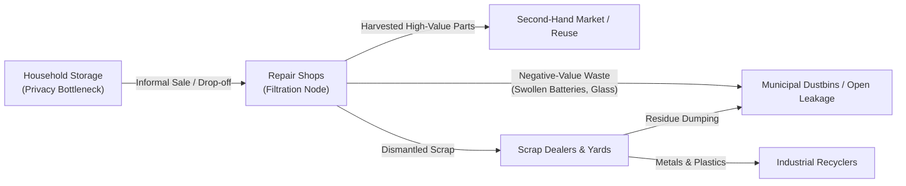

# From Household Storage to Scrap Sorting: Qualitative Evidence on E-Waste Pathways in Bangladesh

[](https://www.ewubd.edu/)
[](https://www.ewubd.edu/)
[](https://youtu.be/hY7pH1-QXpY?si=lkdz8SdRoPy_kQok)
[](#)

---

## 📺 Presentation & Research Overview

- **Video Presentation:** [Watch on YouTube](https://youtu.be/hY7pH1-QXpY?si=lkdz8SdRoPy_kQok)
- **Slide Deck:** [`presentation on paper.pptx`](presentation%20on%20paper.pptx)
- **Full Research Paper:** [`E-Waste Management and Awareness.pdf`](E-Waste%20Management%20and%20Awareness.pdf)
- **Interview & Audio Transcripts Repository:** [Google Drive Archive](https://drive.google.com/drive/u/1/folders/1Z-tfPFyP_bXBXJ1t0qUyO706tpGgPxmM)

---

## 👥 Authors & Supervision

**Department of Computer Science and Engineering, East West University, Dhaka, Bangladesh**

| Name | Student ID | Email |
| :--- | :--- | :--- |
| **Mehadi Hasan Shameem** | 2022-1-60-229 | [mehadihasanshameem314@gmail.com](mailto:mehadihasanshameem314@gmail.com) |
| **Md. Saeikh Abdullah** | 2022-1-60-304 | [saeikh7@gmail.com](mailto:saeikh7@gmail.com) |
| **Shorifa Ahmed Momo** | 2022-1-60-399 | [shorifaahmed404@gmail.com](mailto:shorifaahmed404@gmail.com) |
| **Md. Omor Faruq** | 2022-1-60-335 | [omorfa870@gmail.com](mailto:omorfa870@gmail.com) |

**Faculty Supervisor:**
- **Rashedul Amin Tuhin [RDA]**, Senior Lecturer, Department of Computer Science & Engineering, East West University

---

## 📖 Abstract

Bangladesh’s rapid growth in the adoption of computers, mobile devices, and electronic accessories is accompanied by swelling volumes of electronic waste (e-waste)—generating an estimated 2.8 million metric tons annually, with only a small fraction processed through formal channels. 

This empirical study examines how end-of-life electronics move across informal user–repair–scrap pathways in urban Dhaka. Drawing upon qualitative semi-structured interviews ($N = 13$) with household device users ($N = 6$), repair technicians ($N = 5$), and scrap metal dealers ($N = 2$), supported by non-participant field observations across four major commercial and residential hubs (Shonirakhra, Uttara, Khilgaon, and Panthapath), the study investigates:
1. Real-world e-waste flows,
2. Environmental and health risk perceptions versus workplace reality,
3. Structural barriers to safe disposal, and
4. Economic opportunities for formalization within the green computing paradigm.

---

## 🔍 Key Research Findings

### 1. The Value-Filtered E-Waste Flow (Non-Linear Recycling)
E-waste in Dhaka does not follow an organized circular supply chain. Instead, it moves through a **value-filtered cascade**:
- **Household Retention (Bottleneck):** Users retain non-functional electronics at home indefinitely due to privacy concerns.
- **Repair Shops (Dual Role & Leakage Points):** Technicians extend equipment life by harvesting high-value components (motherboards, displays, ICs) for reuse in the second-hand market. However, "negative-value" components (e.g., swollen lithium-ion batteries, cracked glass) are discarded directly into municipal dustbins due to the absence of a buy-back market.
- **Scrap Dealers (Material Recovery):** Dealers manually dismantle and segment materials (copper, aluminum, plastics) for bulk industrial recyclers while dumping low-grade residues.



### 2. The "Privacy–Policing" Nexus
The paper identifies two critical non-infrastructural bottlenecks:
* **The Privacy Trust Deficit (End-Users):** Users hoard broken devices not out of ignorance or environmental apathy, but out of fear that personal photos, files, and credentials will be extracted and abused.
* **The Legal Precarity & Police Risk (Technicians):** Technicians face police scrutiny and harassment over suspicion of handling stolen phones. Without official proof of ownership or real-time verification tools, second-hand trade is pushed underground, discouraging transparent bookkeeping.

### 3. Awareness vs. Workplace Practice Gap
- **End-Users:** Possess general awareness of e-waste hazards but prioritize personal data security over environmental impact.
- **Technicians & Scrap Dealers:** Exhibit concrete awareness of occupational hazards (toxic rosin soldering fumes, battery explosions, chemical burns, glass cuts), yet rarely adopt Personal Protective Equipment (PPE) due to cost constraints, tight margins, and informal workplace cultures.

---

## 📊 Methodological Overview

- **Approach:** Qualitative field study utilizing semi-structured interviews and non-participant observational field visits.
- **Study Locations:** Dhaka Metropolitan Area:
  1. *Shonirakhra* (Dense residential area)
  2. *Uttara* (Planned urban sector)
  3. *Khilgaon* (Mixed-use commercial and residential zone)
  4. *Panthapath* (High-density IT and electronics hub)
- **Sample Distribution ($N = 13$):**
  - **End-Users ($N = 6$):** University students and office workers (Ages 25–30, 2M/4F).
  - **Repair Technicians ($N = 5$):** 5–20 years experience across roadside stalls and established centers (Ages 41–60, 5M).
  - **Scrap Dealers ($N = 2$):** ~10 years experience in material dismantling and trading (Ages 31–60, 2M).
- **Analysis:** Verbatim transcription from Bangla, translated and coded via inductive Thematic Analysis (Braun & Clarke, 2006).

---

## 💡 Policy & Practical Implications (Green Computing)

To transform informal e-waste pathways into safe, sustainable circular systems, the study outlines four targeted interventions:

1. **Certified Data-Wiping Services:** Establishing authenticated, accessible data destruction kiosks to unlock the massive stockpile of hoarded electronics in households.
2. **Instant Digital Verification (IMEI Checkers):** Equipping repair technicians and second-hand vendors with regulatory-approved verification tools to validate device legitimacy and remove police harassment risks.
3. **Subsidies & Deposit-Refund Schemes:** Creating financial incentives for negative-value hazardous items (especially swollen batteries) so technicians are incentivized to hand them to certified hazardous-waste handlers rather than dumping them into municipal bins.
4. **Integration of Informal Labor:** Formally recognizing scrap dealers and technicians through institutional accreditation, identification cards, and transparent buy-back tariffs.

---

## 📁 Repository Structure

```plaintext
├── E-Waste Management and Awareness.pdf   # Complete academic research paper (12 pages, ACM draft)
├── presentation on paper.pptx            # Presentation slide deck (16 slides)
├── README.md                             # Repository documentation and project brief
└── diagram_used_in_paper/                # High-resolution figures and analytical frameworks
    ├── data.jpg                          # Methodological & qualitative data collection framework
    ├── economic.jpeg                     # The Value-Risk Matrix
    └── flow.png                          # Informal E-Waste Flow & Leakage Points in Dhaka
```

---

## 🔗 Related Resources & Links

- **Presentation Video:** [YouTube Link](https://youtu.be/hY7pH1-QXpY?si=lkdz8SdRoPy_kQok)
- **Audio & Transcripts Archive:** [Google Drive Shared Folder](https://drive.google.com/drive/u/1/folders/1Z-tfPFyP_bXBXJ1t0qUyO706tpGgPxmM)
- **East West University:** [ewubd.edu](https://www.ewubd.edu/)

---

## 📝 Citation

```bibtex
@inproceedings{shameem2025household,
  title     = {From Household Storage to Scrap Sorting: Qualitative Evidence on E-Waste Pathways in Bangladesh},
  author    = {Shameem, Mehadi Hasan and Abdullah, Md. Saeikh and Ahmed, Shorifa and Faruq, Md. Omor},
  year      = {2025},
  publisher = {ACM},
  address   = {Dhaka, Bangladesh},
  note      = {Course Project, CSE407, East West University}
}
```
